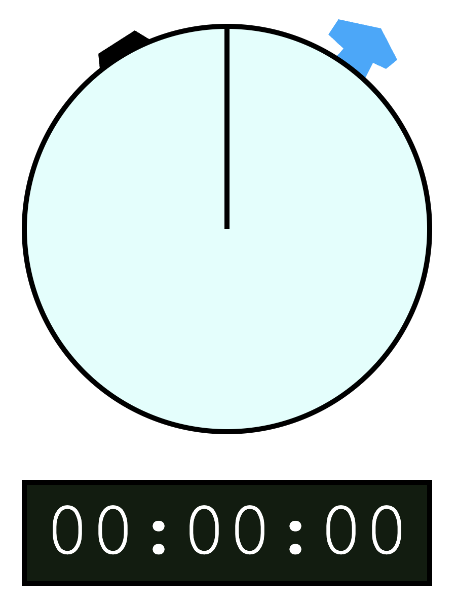
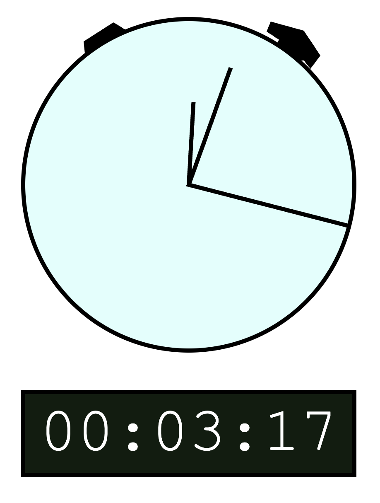
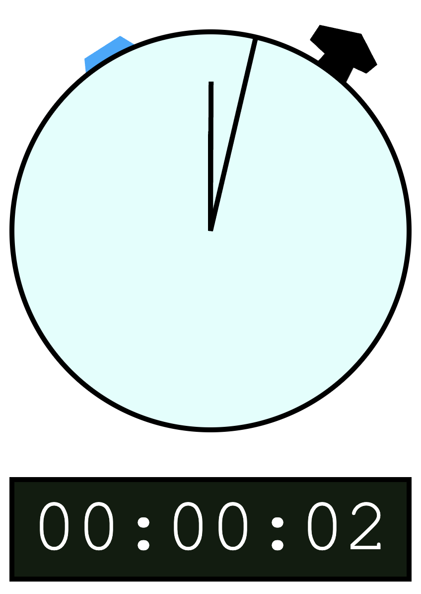

# Assignment 1 - Hello World: GitHub and d3  

## Assignment Link:
https://a2saur.github.io/a1-ghd3/index.html

## Description:
This is an interactive visual stopwatch. There is a simple analog stopwatch visual made of a circle, lines, and polygons, and a digital stopwatch time made of a rectangle and text. The user can press the start button (a polygon) on the right to start/stop the stopwatch and the reset button (another polygon) on the left to reset the timer. 

| | | |
| :---: | :---: | :---: |
 |  | 
| Program on start. This is the simple stopwatch, where the start button (top right of circle) has a mouse hover effect making it blue. | Program running. The stopwatch is at 3 mins and 17 secs, as seen on based on the hands or the digital time below the stopwatch. | Program running. The stopwatch is at 2 seconds and the user is hovering over the reset button, which is currently blue. |

## Achievements
The program uses various ways to make the program more visually appealing and interactive.

### Technical Achievement
I made the visuals animated and interactive. The program uses the `setInterval` function to update the visualization and uses `addEventListener` function to keep track of mouse movement and clicks. The program updates 4/6 of the svg elements with a few behavior changes based on which "buttons" (svg polygons) the user clicks.

### Design Achievement
Rather than just having a timer text with a couple of buttons, I chose to represent the stopwatch with a visual component and the text component for easy use. I added hover effects to the start/stop and reset buttons to make it easier to understand and have the start/stop button appear like it is physically pressed for a more interactive experience.

---

## Sources used in understanding basic D3 Usage:
- [Stack Overflow - SVG and rect in a div](https://stackoverflow.com/questions/71433100/d3-how-can-i-put-an-svg-into-a-div-via-a-function)
- [D3 Graph Gallery - Building shapes](https://d3-graph-gallery.com/graph/shape.html)
- [D3 JS - Line drawing](https://d3js.org/d3-shape/line)
- [W3 Schools - Polygon](https://www.w3schools.com/graphics/tryit.asp?filename=trysvg_polygon)
- [Stack Overflow - Adding text](https://stackoverflow.com/questions/20644415/d3-appending-text-to-a-svg-rectangle)

Note: these resources were just for getting basic syntax rather than larger sections of code, but I figured I would include it.
